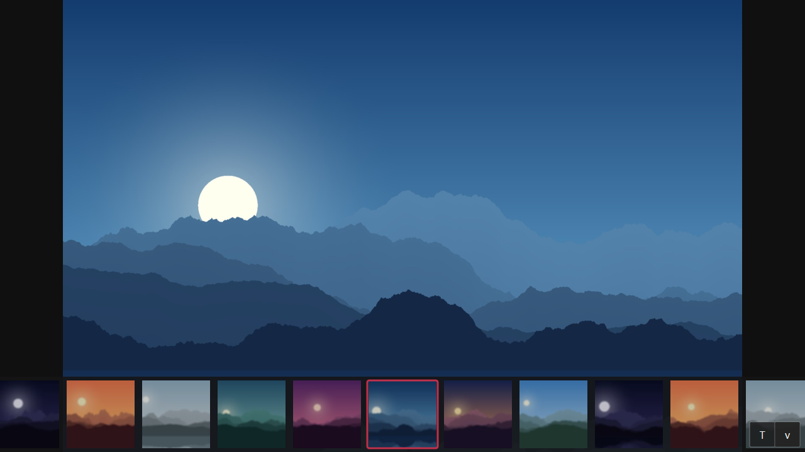
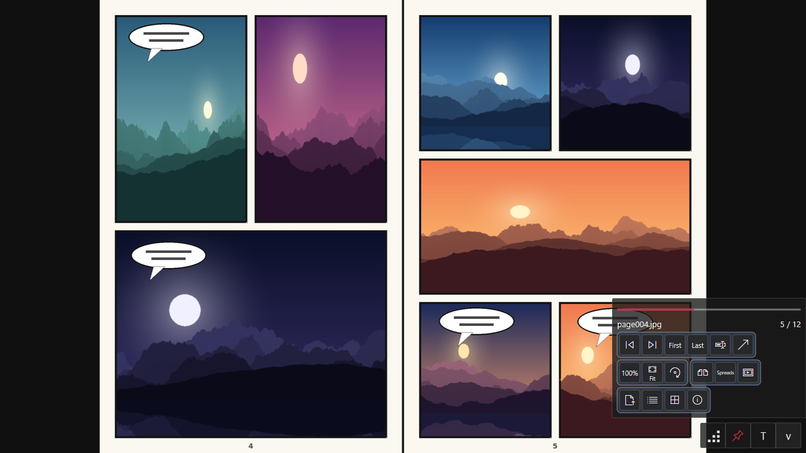
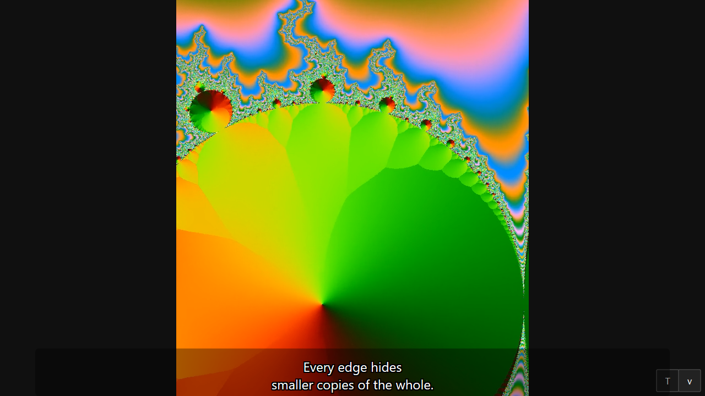
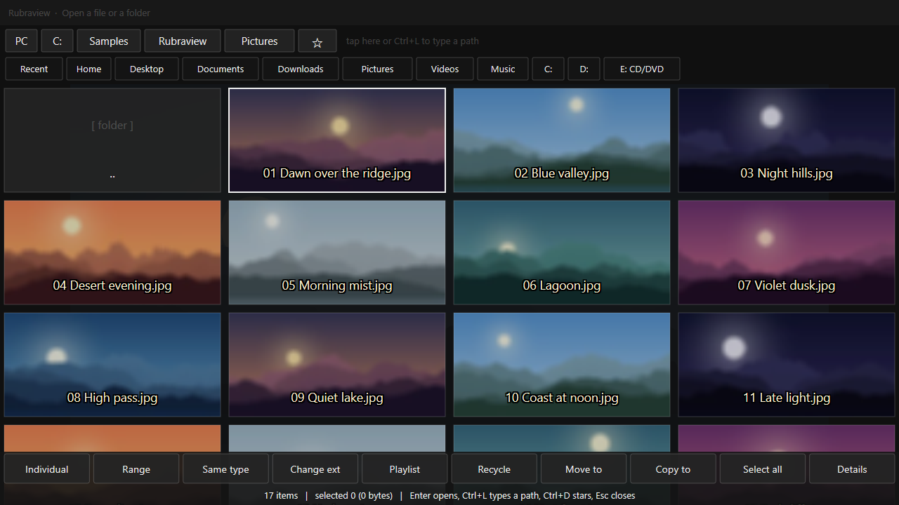
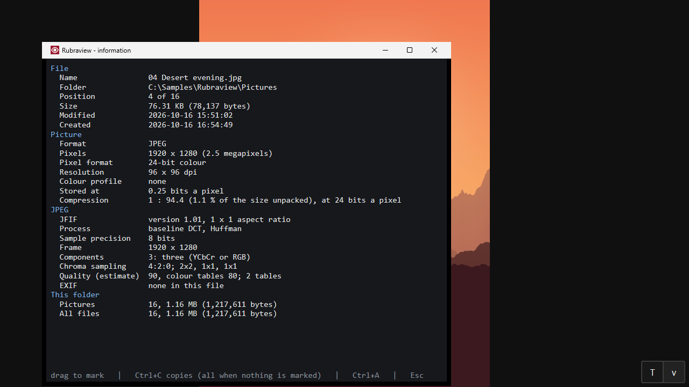
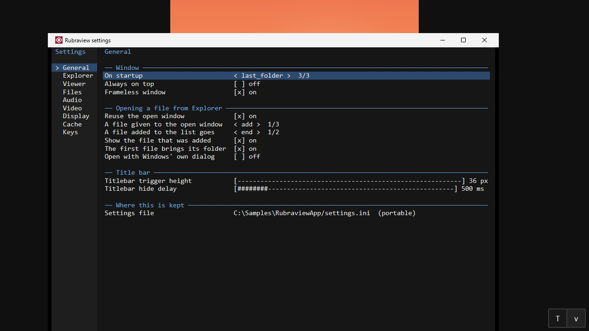

**한국어** | [English](README.md) — **Rubraview v1.39.0** — [Microsoft Store v1.0.0](https://apps.microsoft.com/detail/9n99b2x63k7x) · [ZIP(x64)](https://github.com/rubidus-api/rubraview/releases/download/v1.39.0/rubraview-v1.39.0.zip) · [설치 파일 MSI(x64)](https://github.com/rubidus-api/rubraview/releases/download/v1.39.0/rubraview-v1.39.0.msi) · [EXE만](https://github.com/rubidus-api/rubraview/releases/latest/download/rubraview.exe)

# Rubraview

순수 C23 과 WinAPI 로 지은, 가볍고 빠른 윈도우 멀티미디어 뷰어이자 동영상 재생기이며 일괄 이미지 처리기입니다.

압축을 풀고 `rubraview.exe` 를 실행하거나, `rubraview.exe` 만 받아서 바로 실행하면 됩니다. 설치는 필요 없습니다. [Microsoft Store](https://apps.microsoft.com/detail/9n99b2x63k7x) 에서 받으면 설치와 업데이트가 저절로 됩니다(지금 Store 에 있는 것은 1.0.0 버전입니다). 설치해 두고 싶다면 MSI 를 쓰세요: Program Files 와 시작 메뉴에 넣고, 탐색기 우클릭 메뉴(윈도 11 기본 메뉴 포함)를 모든 사용자용으로 등록합니다. FFmpeg 의 DLL 은 선택 사항으로, Media Foundation 이 못 여는 형식에만 옆에 두면 됩니다. 만화 압축 파일(CBZ/ZIP, CB7/7z, CBR/RAR 2.0~7.0, 솔리드·분할·암호 포함)은 소스에 함께 들어 있는 FultaArc(MIT, UnRAR 코드 없음)로 읽습니다. 압축 파일 안의 페이지는 삭제(`Delete`), 이름 바꾸기(`F2`), 편집 후 저장이 됩니다. ZIP/CBZ 와 7z/CB7 은 형식을 유지하고, 그 밖의 것(솔리드 7z, RAR/CBR, ALZ, EGG, 분할 압축)은 ZIP 과 7z 중 고른 형식으로 새로 쓰며 원본은 휴지통으로 갑니다. 암호가 걸린 압축 파일은 바꾸지 않습니다.

> 정본은 영문 README 이고, 이 문서는 그 번역입니다.

## 스크린샷

|  |  |
|---|---|
|  |  |
| 사진과 필름 스트립 | 만화 두 쪽 보기 |
|  |  |
| 자막이 나오는 동영상 | 파일 열기 화면 |
|  |  |
| 정보 창 | 설정 |

스크린샷 속 사진, 만화, 동영상은 이 스크린샷을 위해 프로그램으로 만든 것입니다.

## 무엇인가

군더더기 없이 빠른 도구를 목표로 합니다. 반응이 빠른 보기, 원본을 건드리지 않는 이미지 보정, 많은 파일을 한 번에 처리하는 일괄 작업을 한 프로그램에 담았습니다.

- **GPU 로 그리는 화면**: Direct2D(D2D1)와 Direct3D 11 로 60~144 FPS 의 부드러운 이동과 소수점 단위 확대.
- **딸린 것 없는 이미지 해독**: JPEG, PNG, GIF, WebP, TIFF, BMP, ICO 를 윈도우의 WIC 로 그대로 엽니다.
- **코덱 설치 없이 AVIF 읽기**: 내장 디코더(libavif + dav1d)가 AVIF 정지 그림과 움직이는 그림을 투명도까지 읽습니다. JPEG XL 은 Windows 에 그 코덱이 설치돼 있거나 FFmpeg DLL 을 프로그램 옆에 두면 열립니다. 움직이는 JPEG XL 은 FFmpeg 으로 재생됩니다. 4 GB 미만의 BigTIFF 도 일반 TIFF 처럼 열립니다.
- **코덱 설치 없이 WebP 쓰기**: 내보내기와 `--batch --format=webp` 가 내장 libwebp 로 손실·무손실 WebP 를 씁니다. 움직이는 GIF·PNG·WebP 는 움직이는 WebP 가 됩니다.
- **동영상 재생**: 분리된 PAL 을 통한 FFmpeg(`libavcodec`/`libavformat`) 연결로 재생, 한 프레임씩 이동, 정지 화면 저장.
- **재생목록으로 인터넷 라디오 듣기**: `.m3u8` / `.m3u` 에 방송 주소(`http`, `https`, `mms`)와 제목(`#EXTINF:-1,제목`)을 적거나 `.pls`, `.asx` 를 열면 재생목록(`P`)에 방송국이 나오고, FFmpeg 가 네트워크만 쓰도록 제한한 채 재생합니다.
- **편집 창의 G'MIC 필터**: 설정 › 외부 도구에서 G'MIC 의 명령줄 프로그램을 지정하면 약 천 개의 필터를 분류별로 골라 각자의 설정으로 실행하거나 G'MIC 명령을 직접 입력할 수 있습니다. G'MIC 은 우리 프로그램 안이 아니라 자기 프로그램으로 실행됩니다.
- **편집 창의 FFmpeg 필터**: FFmpeg 폴더에 `avfilter-12.dll` 이 있으면 FFmpeg 의 영상 필터 약 160개를 이름으로 골라 각자의 설정으로 실행하거나 필터 그래프를 직접 입력할 수 있습니다. 배치에서는 `--ffmpeg-filter`.
- **선택 영역 위의 단계로 편집**: 사각형이나 타원(부드러운 가장자리)을 끌고, 크기를 바꾸고, 숫자로 입력합니다. 톤·색 균형·자동 색 보정·효과 21가지·자르기·크기 조정이 그 위의 단계가 되어 저장 전까지 실행 취소·다시 실행됩니다. 원본에 저장(옛 파일은 휴지통)과 사본 저장이 따로 있습니다.
- **원하는 대로 크기 조정**: 퍼센트, 픽셀, 또는 DPI 기준 cm·mm·인치 길이. HD~8K, 긴 변, 메가픽셀. 선형 광으로 줄이기, 이후 선명하게(Nearest·Bilinear·Bicubic·Lanczos-3).
- **일괄 처리**: 여러 스레드로, 창에서도 명령줄에서도. 크기, 자르기, 여백 자르기, 자동 색 보정, 모든 효과, 캔버스, 테두리, 워터마크, 번호·바꾸기가 있는 이름, 날짜 유지. 선택을 시험하고, 기억하고, 저장하고, 불러옵니다.
- **분류**: 아홉 분류 폴더를 창에 띄우고, 그림을 폴더별로 예약한 뒤 한꺼번에 복사하거나 옮깁니다.
- **그림의 모든 것**: EXIF 전체와 IPTC, 가로세로 비율, 인쇄 크기, 고유 색 수, 디코딩 시간.
- **읽기 좋은 텍스트 파일**: `.txt`, `.log`, `.nfo`, `.md` 를 텍스트로 엽니다. 한국어·일본어·중국어 인코딩을 추측하거나 고를 수 있고, 개행은 그대로 / 한 줄로 이어서 / 빈 줄만 없애기 / 문단 단위 중에서 고릅니다. 들여쓰기를 지우거나 둘 수 있고, 자동 스크롤은 도는 중에도 속도를 바꿉니다. 글자 크기와 행간은 키나 휠 하나로 바꾸고, 찾기·선택·복사가 됩니다.
- **여러 언어**: 영어, 한국어, 일본어, 중국어(간체·번체), 페르시아어. Windows 언어를 따르거나 설정 › General › Language에서 고릅니다. 언어는 프로그램 옆 `lang` 폴더의 텍스트 파일이라, 빌드하지 않고도 고치거나 더할 수 있습니다.
- **순수 C23**: 벤더링한 `proven_c_lib` 의 아레나·문자열 조각·동적 배열 위에서, 힙 파편화 없이.

## 단축키

`F1` 을 누르면 같은 목록이 따로 창으로 뜨고, 보는 동안 열어 둘 수 있습니다.
여기 있는 키는 모두 설정 창(`F10`)의 Keys 쪽에서 바꿀 수 있습니다. 아래 표는
프로그램에 들어 있는 키 설정에서 그대로 만들어지므로 실제와 어긋나지 않습니다.

<!-- keys:begin — generated from src/core/default_keymap.c by scripts/check-actions.py --write; do not edit -->

**어디서나**

| 키 | 하는 일 |
|---|---|
| `F`, `F11`, `Alt+Enter` | 전체 화면 |
| `T` | 툴바 열기/닫기 |
| `Shift+T` | 툴바 고정 |
| `Ctrl+T` | 툴바를 따로 창으로/되돌리기 |
| `Ctrl+Shift+T` | 항상 맨 위 |
| `O`, `Ctrl+O` | 파일 열기 |
| `Ctrl+Shift+O` | 폴더 열기 |
| `F4` | 필름스트립 |
| `Shift+I` | 정보 막대 |
| `E` | 사진 보정 |
| `Ctrl+E` | 내보내기 |
| `Ctrl+Shift+S` | 다른 이름으로 저장 |
| `Ctrl+C` | 화면의 프레임 복사 (영상, 애니메이션), 사진이면 그림 자체 |
| `Ctrl+Shift+E` | 화면의 프레임을 파일 옆에 PNG로 저장 |
| `Ctrl+B` | 여러 파일 변환 |
| `Ctrl+N` | 새 창: 뷰어를 하나 더, 빈 채로 |
| `F10`, `Ctrl+,` | 설정 |
| `F1` | 이 도움말(별도 창) |
| `I`, `Ctrl+I` | 파일 정보(용량, 픽셀 크기, 코덱, EXIF) — 드래그해서 복사 |
| `P` | 재생목록(없으면 이 폴더의 파일) — 화면 위에 떠 있는 창 |
| `Ctrl+R` | 동영상·음악이 끝나면: 정지 / 다음 파일 / 이 파일 반복 / 전체 반복 / 셔플 (툴바 버튼을 누르면 목록에서 고름) |
| `Shift+P` | 미니 플레이어 |
| `G` | 400% 넘으면 픽셀 격자 |
| `Esc` | 끝내기 |
| `Delete` | 휴지통으로; 압축 파일 안의 페이지는 압축 파일에서 삭제(확인함) |
| `Shift+Delete` | 완전 삭제(확인함) |
| `Ctrl+Z` | 이동·복사·이름 바꾸기 되돌리기 |
| `F2` | 이름 바꾸기(압축 파일 안의 페이지도 가능) |
| `Ctrl+Enter` | 이 파일을 선택한 탐색기 창 열기(압축 파일 안이면 압축 파일) |
| `Ctrl+P` | 화면의 그림 인쇄: 회전·크기·배율·위치·여백·한 면의 장수를 고르는 패널, 이어서 시스템 인쇄 창 |
| `F3` | 압축 파일(또는 폴더) 안의 파일 목록을 미리보기와 함께 별도 창으로 — 클릭이나 Enter 로 이동 |
| `F6` | 보고 있는 파일을 지정한 폴더로 복사(압축 파일 안의 페이지도 가능) |
| `K` | 분류: 아홉 폴더를 창에 띄우고 그림을 폴더별로 예약한 뒤 한꺼번에 복사하거나 옮기기 |
| `Ctrl+Shift+R` | 최근 파일 목록 창: 연 날짜, 크기, 위치. 목록에서만 빼거나 전체 지우기 |
| `F7` | 보고 있는 파일을 지정한 폴더로 이동 |
| `Shift+F6` | 보고 있는 파일을 입력하거나 찾아 고른 폴더로 복사(없는 폴더는 새로 만듦) |
| `Shift+F7` | 보고 있는 파일을 입력하거나 찾아 고른 폴더로 이동(없는 폴더는 새로 만듦) |
| `Ctrl+Left` | 창 좁게 |
| `Ctrl+Right` | 창 넓게 |
| `Ctrl+Up` | 창 낮게 |
| `Ctrl+Down` | 창 높게 |
| `Alt+Left` | 창 왼쪽으로 |
| `Alt+Right` | 창 오른쪽으로 |
| `Alt+Up` | 창 위로 |
| `Alt+Down` | 창 아래로 |

**장 넘기기**

| 키 | 하는 일 |
|---|---|
| `PageDown`, `Space`, `Enter`, `.` | 다음 장 |
| `PageUp`, `Backspace`, `Shift+Space`, `,` | 이전 장 |
| `Home`, `Ctrl+Home` | 첫 장 |
| `End`, `Ctrl+End` | 마지막 장 |
| `Shift+Right`, `Ctrl+PageDown` | 열 장 뒤로 |
| `Shift+Left`, `Ctrl+PageUp` | 열 장 앞으로 |
| `Ctrl+Backspace` | 상위 폴더로 |
| `B` | 보기 방식: 한 장 → 두 장 → 책(표지만 한 장) → 웹툰(세로로 이어 보기) → 코믹(가로로 긴 쪽은 반반) 순서로 바꾸기. 두 장·책·코믹 뒤에는 같은 방식의 오른쪽→왼쪽(rtl)이 이어짐 (툴바 버튼을 누르면 목록에서 고름) |
| `Shift+B` | 펼침면 자동 인식 |
| `Ctrl+]` | 폴더의 다음 압축 |
| `Ctrl+[` | 폴더의 이전 압축 |

**보기**

| 키 | 하는 일 |
|---|---|
| `1` | 창에 맞춤 |
| `2` | 너비에 맞춤 |
| `3` | 높이에 맞춤 |
| `4` | 실제 크기(1:1) |
| `0` | 배율 100 %로: 맞춤 옵션이 정한 크기, 가운데 |
| `5` | 똑똑한 맞춤(줄이기만) |
| `6` | 창 가득 늘이기 |
| `Shift+A` | 화면 비율 바꾸기: 원본, 4:3, 16:9, 영화관, 종이 … (돌아가며) |
| `L` | 다음 파일에도 이 맞춤 유지 |
| `+` | 확대 |
| `-` | 축소 |
| `Left` | 확대한 그림: 왼쪽 보기 |
| `Right` | 확대한 그림: 오른쪽 보기 |
| `Up` | 확대한 그림: 위쪽 보기 (웹툰은 스크롤) |
| `Down` | 확대한 그림: 아래쪽 보기 (웹툰은 스크롤) |
| `R` | 시계 방향 회전 |
| `Shift+R` | 반시계 방향 회전 |
| `H` | 좌우 뒤집기 |
| `V` | 위아래 뒤집기 |
| `N` | 도트 그림용 또렷한 확대 |
| `Shift+N` | 열린 압축파일의 파일 이름을 다음 인코딩(Shift-JIS, GBK, Big5 …)으로 다시 읽기 — 그 파일에만 |

**슬라이드 쇼 중**

| 키 | 하는 일 |
|---|---|
| `S`, `F5` | 슬라이드 쇼 시작/정지 |
| `]` | 느리게(0.5초) |
| `[` | 빠르게(0.5초) |
| `Shift+]` | 느리게(0.1초) |
| `Shift+[` | 빠르게(0.1초) |

**영상·음악·움직이는 그림이 떠 있을 때**

| 키 | 하는 일 |
|---|---|
| `Space` | 재생/일시정지 |
| `.` | 한 프레임 앞으로 |
| `,` | 한 프레임 뒤로 |
| `Ctrl+]` | 빠르게(0.25배씩) |
| `Ctrl+[` | 느리게(0.25배씩) |
| `Right` | 5초 뒤로; 툴바 버튼을 길게 누르면 5초·10초·30초·1분·5분이 떠서 끌어다 놓아 고름 |
| `Left` | 5초 앞으로; 툴바 버튼을 길게 누르면 같은 방식으로 5초~5분 |
| `Shift+Right` | 30초 뒤로 |
| `Ctrl+Shift+Right` | 1초 뒤로 |
| `Ctrl+Shift+Left` | 1초 앞으로 |
| `Shift+Left` | 30초 앞으로 |
| `Up` | 소리 5% 크게 |
| `Down` | 소리 5% 작게 |
| `Shift+M` | 음소거/해제 |
| `[` | 여기서부터 반복(A) |
| `]` | 여기까지 반복(B) |
| `\` | 반복 끄기 |
| `Shift+\` | 반복 구간 숫자로: A-B 상자 (툴바 `Set A-B`), A = now·B = now로 지금 재생 위치를 넣음 |
| `Ctrl+\` | 보통 속도 |
| `Z` | 자막 0.5초 빠르게 |
| `X` | 자막 0.5초 늦게 |
| `Shift+Z` | 자막 0.1초 빠르게 |
| `Shift+X` | 자막 0.1초 늦게 |
| `Alt+Z` | 자막 싱크를 원래대로 |
| `A` | 다음 소리 트랙 (툴바 버튼을 누르면 목록에서 고름) |
| `C` | 다음 자막 |
| `Shift+C` | 영상의 자막을 별도 창의 목록으로 — 클릭하면 그 자막으로 이동, 체크박스로 선택, 앞으로/뒤로 버튼으로 선택한 자막 이동 |

**여러 쪽이 든 TIFF·ICO**

| 키 | 하는 일 |
|---|---|
| `.` | 파일 안 다음 쪽 |
| `,` | 파일 안 이전 쪽 |

**단축키 없이 툴바나 오른쪽 클릭에서 쓰는 동작**

| 있는 곳 | 하는 일 |
|---|---|
| 툴바 `Stop`, 오른쪽 클릭 `Stop` | 정지하고 처음으로 |
| 툴바 `1x` | 다음 재생 속도. 위아래로 끌거나 버튼 위에서 휠을 돌리면 0.1x씩 (툴바 버튼을 누르면 목록에서 고름) |
| 툴바 `A-B` | A-B 반복: 여기서부터 → 여기까지 → 끄기 |
| 툴바 `EQ` | 이퀄라이저 다음 프리셋 (툴바 버튼을 누르면 목록에서 고름) |
| 툴바 `EQ bands`, 오른쪽 클릭 `Equaliser window` | 이퀄라이저 10밴드 창 |
| 툴바 `Night` | 야간 모드: 큰 소리를 줄임 |
| 툴바 `Sub`, 오른쪽 클릭 `Subtitles on / off` | 자막 켜기/끄기 |
| 툴바 `100%` | 배율 순환: 실제 크기(0 %), 20 %부터 200 %까지 20 %씩, 다시 실제 크기 (툴바 버튼을 누르면 목록에서 고름) |
| 툴바 `Fit` | 맞춤 순환: 창, 너비, 높이, 스마트, 늘이기, 다시 창 (툴바 버튼을 누르면 목록에서 고름) |
| 툴바 `Viz` | 분석기: 막대 / 파형 / 끔 (툴바 버튼을 누르면 목록에서 고름) |
| 툴바 `Centre` | 그림의 가운데를 창의 가운데로 (크기는 그대로, 더블클릭으로도) |
| 툴바 `Wheel strip` | 휠로 넘길 때 썸네일 |
| 툴바 `Edit` | 텍스트: 설정 > 텍스트의 편집기로 파일 열기 (없으면 메모장) |
| 툴바 `Reload` | 텍스트: 파일을 다시 읽기 (보던 곳 그대로) |
| 툴바 `Delay` | 슬라이드 쇼 딜레이: 탭하면 1, 2, 3, 5, 10초 목록, 위에서 휠을 돌리거나 위아래로 끌면 0.5초씩 |
| 오른쪽 클릭 `Open` | 탐색기에서 우클릭한 것 열기 |
| 오른쪽 클릭 `Look inside (a book)` | 우클릭한 책 안 보기 |
| 오른쪽 클릭 `Add to the list`, 오른쪽 클릭 `Add them to the list` | 고른 것을 목록에 추가 |
| 오른쪽 클릭 `Copy the whole path`, 오른쪽 클릭 `Copy their paths` | 고른 것의 경로 복사 |
| 오른쪽 클릭 `Show in Explorer` | 우클릭한 것을 탐색기에서 보기 |
| 오른쪽 클릭 `Favourite (in or out)` | 우클릭한 파일이나 폴더를 즐겨찾기에 넣거나 빼기 |
| 오른쪽 클릭 `Rename` | 우클릭한 파일이나 폴더의 이름 바꾸기 |
| 오른쪽 클릭 `Change extensions...`, 오른쪽 클릭 `Change their extensions...` | 고른 파일들의 확장자를, 지금 확장자마다 따로 바꾸기 |
| 오른쪽 클릭 `Copy to...`, 오른쪽 클릭 `Copy them to...` | 고른 것을 폴더로 복사 |
| 오른쪽 클릭 `Move to...`, 오른쪽 클릭 `Move them to...` | 고른 것을 폴더로 이동 |
| 오른쪽 클릭 `To the recycle bin`, 오른쪽 클릭 `Them to the recycle bin` | 고른 것을 휴지통으로 |
| 오른쪽 클릭 `Make a playlist of them` | 고른 것으로 재생목록 만들기 |
| 오른쪽 클릭 `Pick none` | 탐색기에서 고른 것 모두 해제 |
| 오른쪽 클릭 `Open` | 목록의 파일 우클릭: 열기 |
| 오른쪽 클릭 `Copy the whole path` | 목록의 파일 우클릭: 전체 경로를 클립보드로 |
| 오른쪽 클릭 `Show in Explorer` | 목록의 파일 우클릭: 탐색기에서 선택해 보여 주기 |
| 오른쪽 클릭 `Take out of the list` | 목록의 파일 우클릭: 목록에서 빼기 (파일은 그대로) |
| 오른쪽 클릭 `Delete the file...` | 목록의 파일 우클릭: 경고하고 확인한 뒤 휴지통으로 |
| 오른쪽 클릭 `Favourites...` | 즐겨찾기(파일과 폴더) 목록 창: 열기, 순서 바꾸기, 빼기 |
| 오른쪽 클릭 `Add to favourites` | 화면의 파일을 즐겨찾기에 넣거나 빼기 |
| 오른쪽 클릭 `One page` | 보기 방식: 한 장씩 |
| 오른쪽 클릭 `Two pages` | 보기 방식: 두 장 나란히 |
| 오른쪽 클릭 `Book` | 보기 방식: 표지만 한 장, 그다음부터 두 장씩 |
| 오른쪽 클릭 `Webtoon` | 보기 방식: 모든 쪽을 세로로 이어서(웹툰) |
| 오른쪽 클릭 `Choose subtitles` | 목록에서 자막 고르기 |
| 오른쪽 클릭 `Take out of film` | Matroska 영상 안의 글자 자막을 영상 옆 파일로 빼내기(`film.kor.srt`, `film.eng.ass`) — 영상은 바꾸지 않음 |
| 오른쪽 클릭 `Slower` | 더 느리게 재생 |
| 오른쪽 클릭 `Faster` | 더 빠르게 재생 |
| 제목 표시줄 ☰ `Pin the title bar` | 제목 표시줄 고정 |
| 제목 표시줄 ☰ `Align the Floating Widget` | 플로팅 위젯을 오른쪽 아래 구석으로 (정보 바가 있으면 그 위로) |

<!-- keys:end -->

## 마우스와 터치

| 이렇게 하면 | 이렇게 됩니다 |
|---|---|
| 창의 왼쪽·오른쪽 부분을 클릭 | 어떤 레이아웃에서도 (오른쪽→왼쪽 읽기 포함) 이전·다음 파일 |
| 가운데를 클릭 | 아무 일도 없음 |
| 그림을 더블클릭 | 그림의 가운데를 창 가운데로 |
| 왼쪽 버튼을 제자리에서 잠시 누르고 있기 | 오른쪽 클릭 목록 |
| 왼쪽 버튼을 누른 채 끌기 | 창보다 크게 확대한 그림, 그리고 웹툰 스트립을 옮김 |
| 툴바의 뒤로/앞으로 버튼을 길게 누름 | 버튼 위에 5초·10초·30초·1분·5분이 뜸 — 끌어다 놓아 고름 (짧게 누르면 5초) |
| 툴바의 탐색 막대를 클릭 | 그 위치로 이동 (동영상, 음악, 움직이는 GIF/WebP/PNG) |
| 가운데 버튼 클릭 | 실제 크기 ↔ 창에 맞춤 |
| 마우스의 뒤로/앞으로 버튼 | 이전/다음 쪽 |
| 영상·음악 위에서 클릭 | 일시정지/재생 |
| 그림 위에서 휠, `Ctrl` + 휠, 또는 줌 버튼 위에서 휠 | 확대/축소, 한 칸에 10 % |
| 줌 버튼 클릭 | 실제 크기(0%), 20%부터 200%까지 20%씩, 다시 실제 크기 |
| 여러 개 중 하나를 고르는 툴바 버튼 위에서 휠 | 앞이나 뒤의 것으로 |
| 툴바의 진행 막대 위에서 휠 | 파일 이름과 안내 메시지 크기 |
| 영상·음악 재생 중 휠 | 음량 |
| `Shift` + 휠 | 10쪽 뒤로/앞으로 |
| 필름스트립 위에서 휠 | 썸네일을 넘김, 썸네일을 클릭하면 그 그림으로 |
| 플로팅 위젯 **F**: 클릭, 끌기, 휠, `Alt` + 휠 | 툴바 열기/접기 (고정되지 않음), 위젯 이동, 한 줄의 버튼 수, 투명도 |
| 플로팅 위젯 **T**: 포인터, 끌기, 휠 | 포인터를 올리면 툴바가 열림, 위아래로 파일 이동·옆으로 폴더나 압축 파일 이동, 버튼 크기 |
| 창 맨 위 가장자리에 포인터 | 제목 표시줄: ☰ (메뉴), 이름 (파일 열기 화면), **Set P H T F _ [] R X**. 끌면 창 이동, 두 번 클릭하면 최대화 |
| 왼쪽·오른쪽 가장자리 가운데 근처에 포인터 | 이전·다음 쪽 버튼 |
| 파일이나 폴더를 창에 끌어다 놓기 | 열기 |
| 터치: 끌기, 두 손가락 벌리기 | 그림 옮기기, 확대/축소 |

## 다른 창에서 쓰는 키

각 창에 고정된 키이며 단축키 설정에는 나오지 않습니다.

| 어디서 | 키 |
|---|---|
| 파일 열기 화면 (`O`) | 방향키로 이동, `Enter`로 열기 (`Shift+Enter`는 압축 파일의 쪽들을 타일로), `Backspace`는 위 폴더, 글자·숫자는 그 글자로 시작하는 다음 이름으로, `Ctrl+L`은 경로 입력, `Ctrl+D`는 폴더 즐겨찾기, `Esc`는 닫기. 압축 파일을 오른쪽 클릭하면 그 안의 쪽들, 즐겨찾기를 오른쪽 클릭하면 이름 바꾸기 |
| 파일 목록 창 (`F3`) | `Up` / `Down`, `PageUp` / `PageDown`, `Home` / `End`로 파일을 골라 미리보기, `Enter`나 클릭으로 그 파일로 이동, `Esc`로 닫기. 그 밖의 키는 뷰어에서와 같이 동작 |
| 설정 (`F10`) | `Up` / `Down` 이동, `Left` / `Right` 값 바꾸기 (`PageUp` / `PageDown`은 열 단계씩), `Enter`나 `Space`로 켜고 끄거나 누르기, `Tab` / `Shift+Tab` 쪽 바꾸기, `Esc` 닫기 |
| 도움말 (`F1`), 파일 정보 (`I`) | `Up` / `Down`, `PageUp` / `PageDown`, `Home` / `End`로 스크롤, `Esc`로 닫기 |
| 재생 목록 (`P`) | 클릭하면 그 파일로, 휠로 스크롤, `Esc`로 닫기 |
| 이름 바꾸기 (`F2`), 경로 입력, 암호 | `Enter` 확인, `Esc` 취소 |

## 보기 방식

`B`, 툴바의 Layout 버튼, Menu > View > Layout에서 여덟 가지 중 하나를 고르고, Settings > Viewer > Layout에 그대로 저장됩니다:
**single**(한 장), **dual**(두 장 나란히), **book**(표지만 한 장, 그다음부터 두 장), **webtoon**(모든 쪽을 같은 폭으로 세로로 이어
하나의 긴 스트립으로)과 **comic**(한 장씩, 가로로 긴 쪽은 반반 나눠서). 그리고 dual, book, comic 바로 뒤에 각각
**dual-rtl**, **book-rtl**, **comic-rtl**이 있습니다. 일본 만화책처럼 오른쪽에서 왼쪽으로 읽는 책을 위한 것으로, 앞 쪽이
오른쪽에 놓이고, 가로로 긴 쪽은 오른쪽 절반부터 보이며, 클릭과 밀기로 넘기는 방향도 반대가 됩니다.

## 탐색기 우클릭 메뉴

Settings > Explorer에서 켠 확장자에 **Rubraview** 항목을 등록합니다. 열기, 이것만 열기, 재생목록에 넣기, 압축 파일 내부 보기,
변환..., 인쇄...가 있고, 파일 하나에도 여러 개를 함께 선택한 경우에도 동작합니다. "이 사용자"로 등록하면 옛 메뉴(Windows 11에서는
"추가 옵션 표시")에 들어가고, "모든 사용자"(관리자 권한 한 번)로 등록하면 zip에 든 `rubraview_menu.dll`과 `rubraview_menu.msix`로
Windows 11 새 메뉴에도 들어갑니다(두 파일은 `rubraview.exe` 옆에 그대로 있어야 합니다). MSI 로 설치하면 이 등록을 설치할 때 해 줍니다. 일반 압축 파일(ZIP, 7z, RAR, ALZ, EGG)은 메뉴만 받고, 더블 클릭 연결은 바뀌지 않습니다.

## 명령줄

| 실행 | 용도 |
|---|---|
| `rubraview.exe 파일` (폴더나 압축 파일도) | 열기. 이미 떠 있는 창이 있으면 그 창 목록 맨 끝에 넣고 보여 줌 (Settings > General > Opening a file from Explorer에서 바꿈) |
| `--sort=natural\|lexical\|modified\|created\|size\|random`, `--descending`, `--ascending` | 이번 실행의 폴더 정렬 (설정보다 우선) |
| `--recursive` (`--batch` 없이) | 하위 폴더까지 한 목록으로 |
| `--new-instance`, `--new-window 파일들...` | 설정과 상관없이 새 창 |
| `--register-shell`, `--unregister-shell` | Windows가 파일을 Rubraview로 열게 하고 탐색기 우클릭 메뉴에 Rubraview를 넣거나, 되돌림. `--types=jpg,png,comics,...`(확장자, 또는 `pictures`, `comics`, `video`, `music`, `archives`, `all`)로 일부만, `--no-types` / `--no-menu`로 둘 중 하나는 그대로 두고, 관리자 프롬프트에서 `--all-users`로 모든 사용자용(Windows 11 새 메뉴 포함). `--setup`은 설치 파일이 쓰는 것(Windows 11 메뉴만 등록하지 못했을 때도 0으로 끝남). Settings > Explorer에도 같은 기능이 있음 |
| `--wipe-shell` | 탐색기 우클릭 메뉴와 파일 형식에서 Rubraview 항목을 모두 지움. 구버전이나 다른 폴더의 사본이 등록한 것도 포함. 관리자 프롬프트에서 `--all-users`를 붙이면 모든 사용자 대상. |
| `--open`, `--new-window`, `--open-only`, `--add`, `--browse`, `--convert`, `--print` `파일들...` | 우클릭 메뉴 항목이 실행하는 것: 열기, 새 창에서 열기, 이것만 열기, 열린 창의 목록에 넣기, 압축 파일 내부 보기, 이 파일들로 배치 패널, 인쇄 |
| `--batch ...` | 창 없이 여러 파일 변환. 옵션은 [설명서](docs/manual/rubraview-manual.md)에 |
| `--version` | 버전 |

## 무엇으로 지었나

- **언어**: 순수 ISO C23 (`-std=c23`)
- **화면**: Win32 GUI, Direct2D 1.1+, DirectWrite, DXGI
- **코덱**: Windows Imaging Component(WIC), FFmpeg(`libav*` 동적 연결)
- **바탕 라이브러리**: `proven_c_lib`(메모리 아레나, `u8str`, 동적 배열)
- **이식성**: 핵심 알고리즘은 리눅스에서 그대로 시험하고, 윈도우 실행 파일은 리눅스 빌드 기계에서 MinGW-w64 로 교차 빌드합니다.

## FFmpeg (선택)

대부분의 파일은 윈도우 자체 디코더로 재생됩니다. FFmpeg 은 그것으로 못 여는
형식에만 필요하고, **`ffmpeg.exe` 가 아니라 DLL 다섯 개**입니다.

```
avcodec-63.dll  avformat-63.dll  avutil-61.dll  swscale-10.dll  swresample-7.dll
```

[BtbN 의 윈도우 빌드](https://github.com/BtbN/FFmpeg-Builds/releases) 에서
`ffmpeg-n9.0-latest-win64-lgpl-shared-9.0.zip` 을 받으세요. 반드시 **9.0**
이어야 하고 이름에 **shared** 가 있어야 합니다. `shared` 가 없는 판에는 실행
파일만 있고 DLL 이 없으며, 다른 판은 DLL 이름의 번호가 달라 루브라뷰가 쓰지
않습니다. 압축을 원하는 곳에 푼 다음, 설정(`F10`) › External(외부 도구) ›
**FFmpeg folder** 에 그 `bin` 폴더를 지정하면 바로 쓰입니다. (`rubraview.exe`
옆에 두어도 되며, 이때는 다시 실행해야 합니다.) `lib` 폴더의 `.dll.a`, `.lib`
는 FFmpeg 을 링크해 빌드할 때 쓰는 것이라 실행에는 쓰지 않습니다 — 그냥 두세요.

설정 › External 에서 인식 여부와 위치를 보여 주고, 내려받는 곳의 링크도
있습니다. 루브라뷰는 FFmpeg 을 함께 배포하지 않습니다.

## 문서

- [사용 설명서](docs/manual/)

## 빌드

### 윈도우 실행 파일(교차 빌드)
```sh
make win64
```

## 라이선스

MIT License. [LICENSE](LICENSE) 를 보세요.
